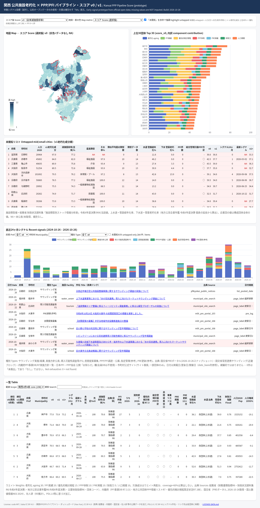

# Kansai PPP/PFI Pipeline Dashboard / 関西 PPP/PFI パイプライン・ダッシュボード

**Live site / 公開ページ:** https://stesea1.github.io/kansai-ppp-dashboard/

## English

A free, open-data dashboard that shows **which municipalities in the Kansai region are likely to launch PPP/PFI projects next**, by combining public-facility ageing data with each municipality's PPP track record and readiness.

- **Coverage:** 198 municipalities in Osaka, Kyoto, Hyogo, Nara, Wakayama and Shiga, plus Mie (29) and Fukui (17) as an option — 244 in total.
- **What you can see:**
  - A map and sortable table of a transparent *PPP pipeline score* for every municipality (v0, and an optional v1 that uses facility-type ageing).
  - Ageing rates (有形固定資産減価償却率) for the municipality overall and for 16 facility types — schools, public housing, gyms and pools, libraries, waste-treatment plants, city halls and more — compared with the average of similar municipalities.
  - Water-pipe and sewer-pipe ageing, calculated from the FY2024 (令和6年度) Local Public Enterprise Yearbook.
  - An **"untapped" list**: mid-sized and small cities (population 20,000–200,000) with severe facility ageing but no PPP priority-review rule (優先的検討規程) and almost no PFI track record yet.
  - **Recent signals (24 months, 2024-10-26 – 2026-10-26):** a timeline and filterable list of sounding (market dialogue) calls/results, PPP/PFI implementation-policy announcements, private-proposal calls, feasibility studies and PPP procurements, each linked to the original page (`data/signals.csv`). An optional **v1+** score adds this as a 10-weight component; v0 and v1 are unchanged. The list is not exhaustive (0 = not found, not "none").
- **Score components (v0):** facility ageing 30%, PFI track record 20%, priority-review rule 15%, PPP organisation 10%, listings on MLIT's PRE portal 10%, population 10%, fiscal capacity 5%. Missing data is never imputed; the remaining weights are re-normalised and data coverage is shown.
- **Data sources:** Ministry of Internal Affairs and Communications (財務書類指標, 財政状況資料集, 地方公営企業年鑑, 主要財政指標), Cabinet Office PFI database and PPP information list, MLIT PRE portal and National Land Numerical Information (N03), and IPSS population projections. All data is processed from official open data; see `data/sources_inventory.csv`.
- **Limitations:** the score leans towards large cities, weights are set by judgement and not yet back-tested against actual tenders, and some data is missing (e.g. facility-type data for Shiga). Treat it as a first screen, not as investment or business advice.
- **Rebuild:** `python3 scripts/geo.py && python3 scripts/extract_shisetsu.py && python3 scripts/water.py && python3 scripts/signals_collect.py && python3 scripts/signals_resolve.py && python3 scripts/build.py`

### License
- **Code** (`scripts/`, `web/*.html`, hand-written JS): MIT — see [LICENSE](LICENSE). `web/echarts.min.js` is Apache ECharts under the Apache License 2.0.
- **Processed data** (`data/`, `web/data.js`, `web/geo.js`): CC BY 4.0 — see [LICENSE-DATA.md](LICENSE-DATA.md). Attribution: *関西PPP/PFIパイプライン・ダッシュボード (Hao Yue), CC BY 4.0*. You must also credit the underlying official sources (PDL1.0 / CC BY 4.0 compatible) and note that the data was processed. Signal titles/URLs and rows taken from the Japan PFI/PPP Association's notices are excluded from the CC BY grant (see LICENSE-DATA.md).

Author: Hao Yue

## 日本語

関西の市町村のうち、**次に PPP/PFI 事業が動き出しそうな自治体はどこか**を、公共施設の老朽化データと各自治体の PPP 実績・体制を組み合わせて可視化する、無料のオープンデータ・ダッシュボードです。

- **対象:** 大阪・京都・兵庫・奈良・和歌山・滋賀の 198 市町村（オプションで三重 29・福井 17、計 244 団体）。
- **主な機能:**
  - 全団体の「PPP パイプライン・スコア」を地図と並べ替え可能な一覧表で表示（v0、および施設類型別の老朽化を用いる v1）。
  - 有形固定資産減価償却率（団体全体および学校・公営住宅・体育館/プール・図書館・一般廃棄物処理施設・庁舎など 16 類型）と、類似団体平均との比較。
  - 令和6年度地方公営企業年鑑から算出した水道管路経年化率・下水道管渠老朽化率。
  - **「未開拓」リスト:** 人口 2 万〜20 万の中小都市のうち、老朽化が進んでいるのに優先的検討規程が未策定で、PFI 実績もほとんどない団体。
  - **直近24ヶ月シグナル（2024-10-26〜2026-10-26）:** サウンディング型市場調査の実施・結果、実施方針公表、民間提案募集、導入可能性調査、PPP/PFI 調達等を時系列グラフと一覧で表示し、原典ページにリンク（`data/signals.csv`）。任意の **v1+** スコアでこれを重み 10 の成分として加えます（v0・v1 は変更なし）。網羅的ではありません（0 件＝「未検出」）。
- **スコア構成（v0）:** 老朽化 30%、PFI 実績 20%、優先的検討規程 15%、PPP 体制 10%、PRE ポータル掲載 10%、人口規模 10%、財政力 5%。欠損値は補完せず、残りの重みで再計算し、データ充足率を表示します。
- **出典:** 総務省（財務書類指標・財政状況資料集・地方公営企業年鑑・主要財政指標）、内閣府（PFI 事業データベース・地方公共団体 PPP 情報リスト・優先的検討規程の策定状況）、国土交通省（PRE ポータル・国土数値情報 N03）、国立社会保障・人口問題研究所（地域別将来推計人口）。いずれも公開データを加工して作成しています。詳細は `data/sources_inventory.csv` を参照してください。
- **留意点:** スコアは大都市に有利な傾向があり、重みは主観的に設定したもので実際の入札結果による検証はまだです。一部データ（滋賀県の施設類型別データなど）が欠けています。一次的なスクリーニングとしてご利用ください。

### ライセンス
- **コード**（`scripts/`、`web/*.html`、自作 JS）: MIT（[LICENSE](LICENSE)）。`web/echarts.min.js` は Apache ECharts（Apache License 2.0）。
- **加工データ**（`data/`、`web/data.js`、`web/geo.js`）: CC BY 4.0（[LICENSE-DATA.md](LICENSE-DATA.md)）。表示例:「関西PPP/PFIパイプライン・ダッシュボード (Hao Yue), CC BY 4.0」。あわせて原典（PDL1.0 等、CC BY 4.0 互換）の出典と加工した旨を記載してください。シグナルの件名・URL および日本PFI・PPP協会「お知らせ」由来の行は CC BY の対象外です（LICENSE-DATA.md 参照）。

作成者: Hao Yue

---
中文技术说明 / Technical notes (Chinese): [README_zh.md](README_zh.md)
